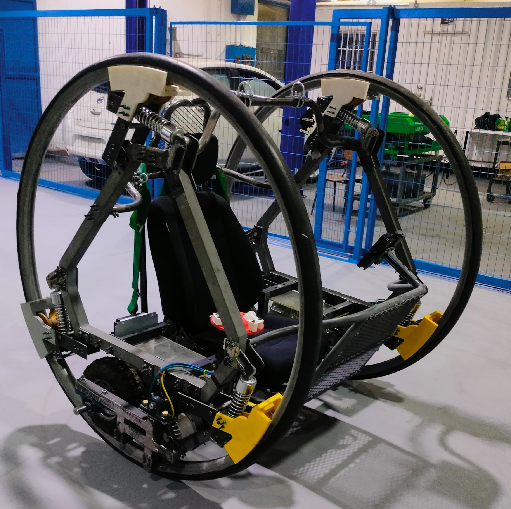
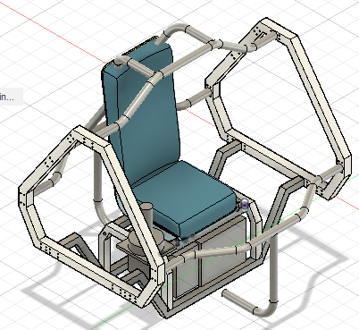
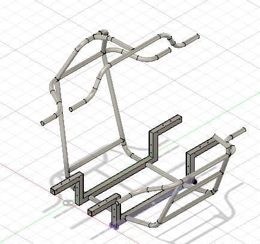
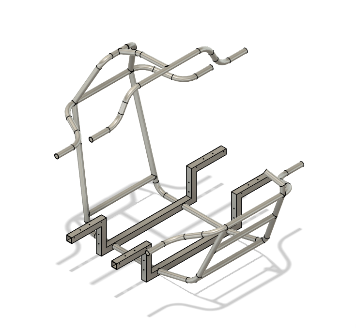
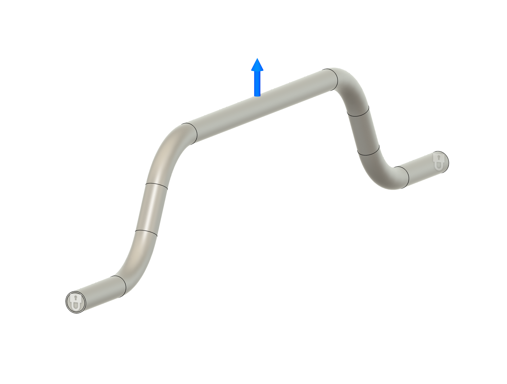

# DiWheel tubular chassis

**Mechanical development project | Universidad de Chile | 2025**

[Back to portfolio](../../README.md)

*The team's assembled mechanical prototype, from the final design report, Figure 26. My work was within the chassis team; the complete vehicle includes other teams' wheel and powertrain work.*

## Engineering objective

Develop a tubular chassis and its connections to the lateral triangular structures of a DiWheel vehicle. The chassis needed to accommodate the driver, seat, lifting attachment and interfaces with the wheel and drive systems.

## My contribution

- Co-designed the tubular chassis and lateral-triangle connections with the chassis team.
- Contributed to structural and bolted-joint load calculations.
- Selected tube steel grade, diameters and wall thicknesses with the team.
- Used Fusion 360 for CAD and SolidWorks Simulation for structural analysis.
- Participated in prototype static testing and alignment measurements.

## Requirements and interfaces

| Requirement | Engineering consideration |
| --- | --- |
| Vehicle and driver design mass of 300 kg | Define the loading basis for the mechanical structure |
| Drop height of 100 mm | Assess the specified impact loading scenario |
| Lateral triangular planes parallel within ±2°, with and without load | Control alignment and deformation of the wheel-supporting structures |
| Suspended lifting | Assess loading through the chassis lifting attachment |
| Seat, motor and electronics integration | Provide space, mounting surfaces and assembly access |

The drop height and parallelism values follow the final team report. They are design requirements, not measured prototype results.

## From concept to a manufacturable chassis

| Initial chassis iteration | Final chassis iteration |
| --- | --- |
|  |  |

*Team CAD iterations from Figures 2 and 3 of the report.*

The team revised the distance between the triangular structures and the arrangement of crossmembers to accommodate the seat and avoid interference with other subsystems. The design combined bent round tubes with square sections providing flat mounting surfaces. Bolted interfaces supported assembly and removal of components.

*Chassis model from Figure 27. The report describes a 3D skeleton-sketch approach used to define the tube arrangement and intersections for manufacturing documentation.*

## Structural assessment

My structural-analysis work used SolidWorks Simulation to examine chassis loading and connections. One of the report's load cases applies a lifting force to the upper crossmember while constraining its end connections:

*Load and constraint setup from Figure 31. This illustrates the assessment setup; it does not establish a verified factor of safety for the complete vehicle.*

## Prototype outcome

The mechanical prototype was assembled, and I participated in static evaluation and alignment measurements. The measured deviation is not quoted because the original measurement record has not been recovered. Electrical and control development subsequently passed to another group; dynamic vehicle performance is outside the scope of this case.

## What this project demonstrates

- Translating packaging and alignment requirements into a mechanical structure.
- Connecting CAD, material selection, load assessment and manufacturing constraints.
- Coordinating chassis interfaces with other vehicle subsystems.
- Taking a team design through construction and static evaluation.

## Source and credit

The figures are original team deliverables from *Informe Final Diwheel*, Universidad de Chile, July 2025. My contribution is described above; team CAD, photographs and simulation figures are not presented as exclusively my work. See the [figure source record](assets/README.md).

