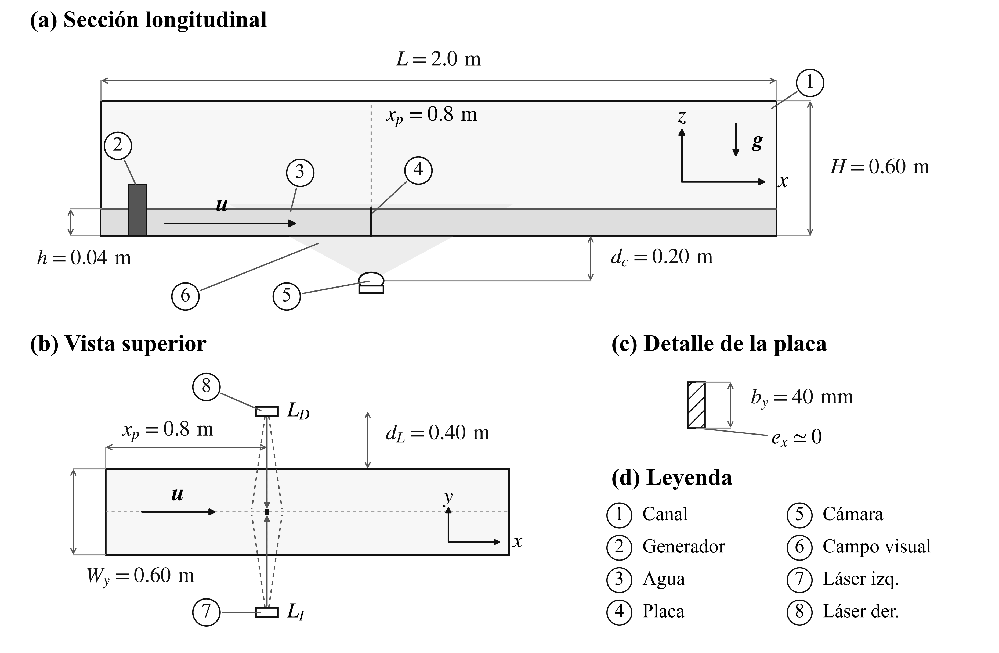
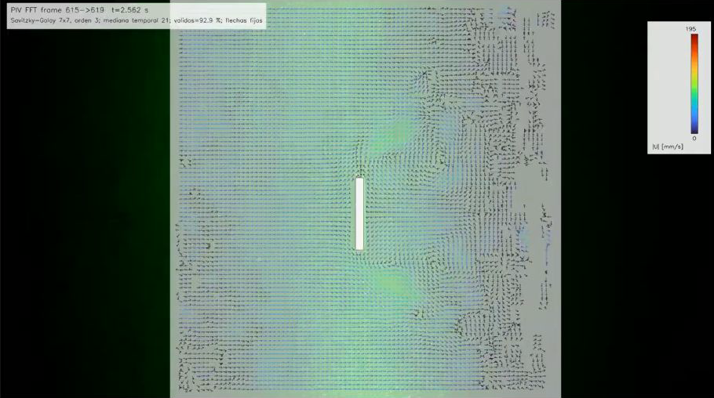
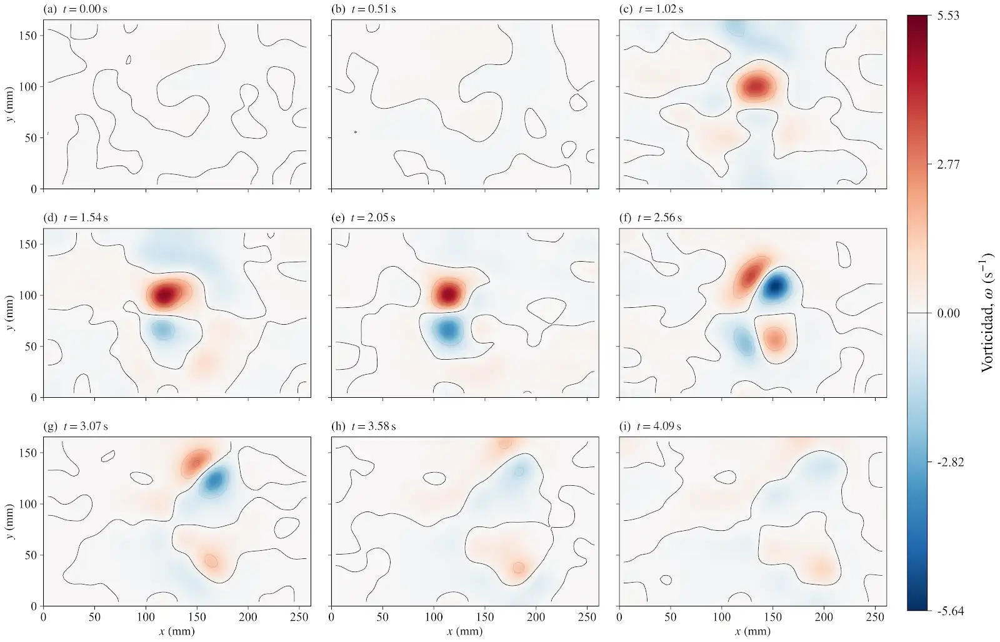

# Experimental flow measurement with PIV

**Research thesis in progress | LEAF-NL, Universidad de Chile | March 2026–present**

[Back to portfolio](../../README.md)

## Engineering objective

Build an experimental platform and image-processing workflow to investigate the interaction of an undular bore with partially submerged objects. The work connects mechanical equipment, instrumentation and analysis of unsteady flow.

*Figure 1. Experimental setup from my thesis material: channel, wave generator, water, plate, camera and illumination. The diagram includes dimensions and the initial water depth of 0.04 m. Original Spanish component labels are retained.*

## My contribution

- Designed and built the wave-generation system using a DC motor, timing belts and 3D-printed components.
- Integrated encoder and current measurements with Arduino control and a computer interface.
- Implemented multi-pass particle image velocimetry in Python and MATLAB, using NumPy FFT for image-pair cross-correlation in Python.
- Implemented image calibration, preprocessing, vector validation and conversion to physical units.
- Calculated velocity and vorticity fields, positive and negative circulation, and their temporal evolution.

## Processing workflow

1. Calibrate the image scale and preprocess recordings using thresholding and Gaussian filtering.
2. Estimate displacements with FFT-based cross-correlation within a multi-pass scheme.
3. Validate vectors and convert displacements into physical velocities.
4. Calculate vorticity and integrate its positive and negative components separately to evaluate circulation.
5. Analyse field maps and time histories across experimental cases.

Recordings are acquired at 240 fps. In the documented 60° example below, images within a pair are separated by four camera frames, giving Δt = 4/240 s, approximately 16.7 ms. Consecutive PIV pairs advance by one camera frame.

## Representative experimental output — 90° plate case

These figures feature a 90° plate test at a time when the vorticity structures are clearly visible. The velocity snapshot is labelled t = 2.562 s; the vorticity montage includes the corresponding t ≈ 2.56 s sample. Each image retains its original annotations and colour scale.

### Velocity field at t = 2.562 s

*Figure 2. Velocity field from frame pair 615→619. The overlay reports a 7×7 Savitzky–Golay filter, polynomial order 3, a 21-measurement temporal median and 92.9% valid vectors. Colour represents speed from 0 to 195 mm/s. Arrow lengths are fixed for display, so arrows show direction and do not independently encode speed. This frame was selected from the [90° velocity-field sequence on Drive](https://drive.google.com/file/d/1ToeXWVffcljyM51Gw_vy7CaFTNcOydHT/view).*

### Vorticity sequence and intense structures

*Figure 3. Nine samples at t = 0.00, 0.51, 1.02, 1.54, 2.05, 2.56, 3.07, 3.58 and 4.09 s. The montage uses a shared colour scale from −5.64 to +5.53 s⁻¹; the t ≈ 2.56 s panel shows strong, opposite-signed structures. The plotted axes, labels and scale are preserved from the Drive preview.*

### Additional processing parameters documented for a 60° run

| Parameter | Recorded value |
| --- | --- |
| Acquisition rate | 240 fps, explicitly overriding slow-motion file metadata |
| Image-pair separation | 4 camera frames; Δt ≈ 16.7 ms |
| First / second interrogation windows | 64×64 / 48×48 px |
| Window overlap | 50% / 75% |
| Search limits | 20 / 16 px |
| Spatial scale | Approximately 0.1937 mm/px |
| Final vector-grid step | 12 px |
| Temporal filter | Median over up to 21 measurements |
| Spatial post-processing | Separable Savitzky–Golay, 7×7 vector nodes, polynomial order 3 |
| Vorticity post-processing | Gaussian smoothing, σ = 3 vector-grid nodes |

The table above describes the earlier 60° case, not the 90° figures shown first. Settings should be recalibrated for other recordings rather than assumed to apply to every test. See the [processing record](processing-record.json). The earlier [60° velocity](assets/velocity-example.png) and [vorticity](assets/vorticity-example.png) snapshots are retained as supporting examples.

## Code and processing documentation

- [Multi-pass PIV processor](code/procesar_piv.py): image preprocessing, direct/FFT correlation, subpixel peak refinement, vector rejection, calibration and export.
- [Post-processing and rendering sources](code/README.md): compact fields, smoothing and vorticity output.
- [How to configure a recording](code/README.md#configuration-and-use).

The Python files are selected research-source snapshots from the Drive project. The full raw videos and compact datasets remain outside this repository. The figures above are existing research outputs, rather than a new execution of the scripts during portfolio preparation.

## Outputs and current scope

The workflow produces velocity fields, vorticity maps and circulation time histories. Experiments with the plate at different orientations are underway. The thesis is an experimental water-channel study; its connection to aerodynamic testing lies in the measurement and analysis methods.

The processing rejects vectors using masks, image-content checks and correlation criteria. These checks assess vector quality; they do not establish measurement accuracy against independent ground truth. This case makes no numerical uncertainty claim. Positive and negative circulation analysis forms part of the thesis, but a circulation result series is not included in this selected example.

## Tools

Python (NumPy, SciPy FFT, OpenCV, Matplotlib), MATLAB, Arduino/C; spatial calibration, multi-pass PIV, image filtering, vector validation, encoder and current measurement.
