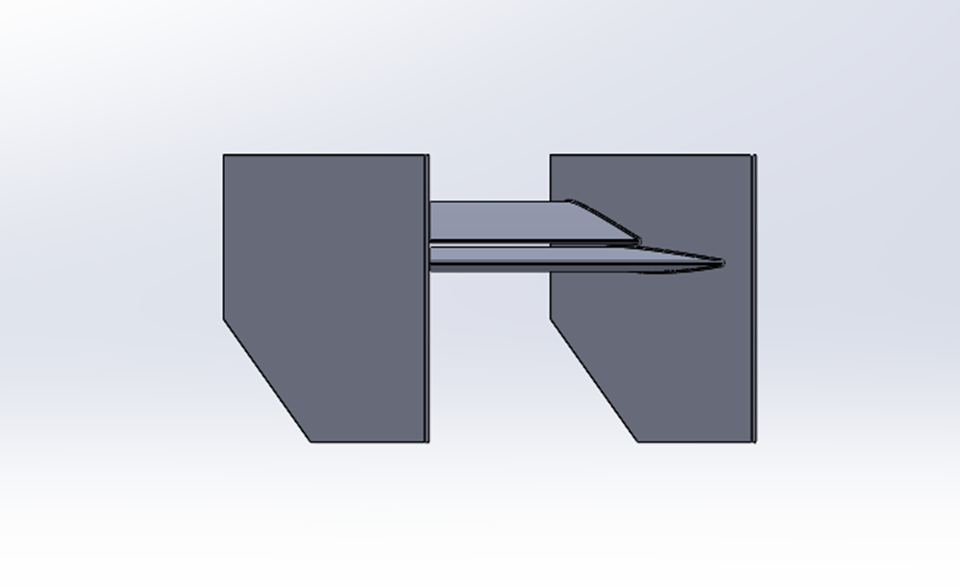
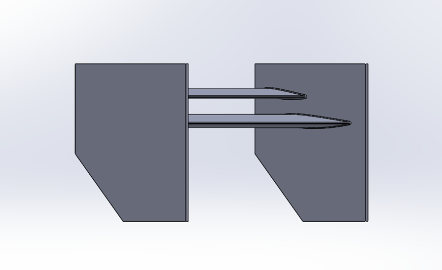
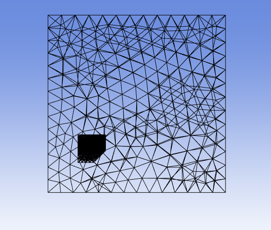
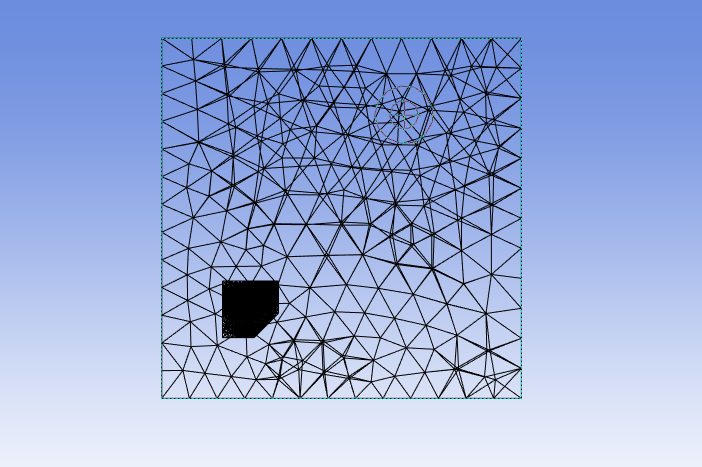
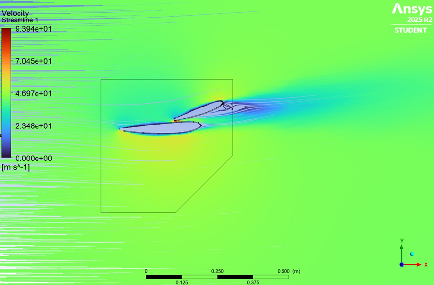
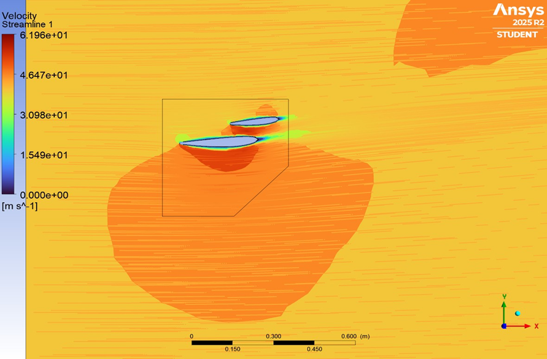
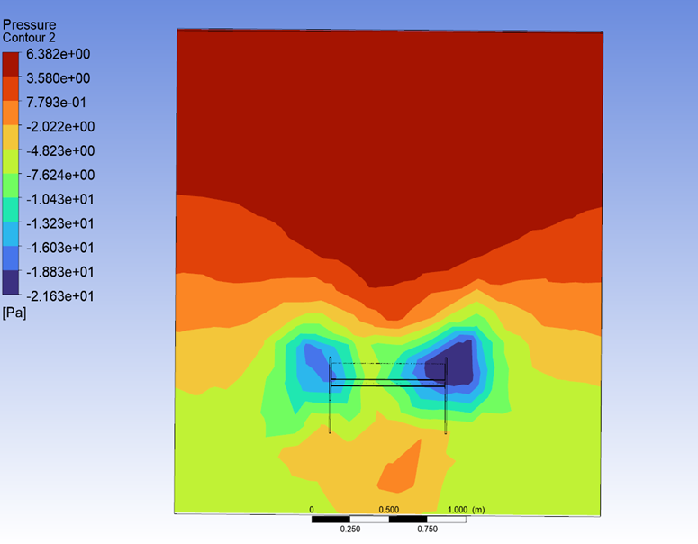
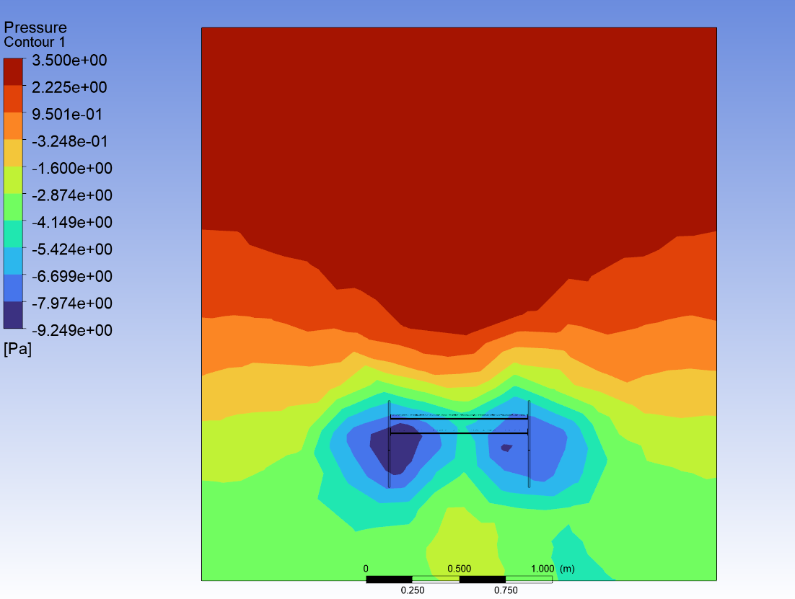

# Two-element rear-wing CFD study

**Computational Fluid Mechanics course project | Universidad de Chile | Spring semester 2025**

[Back to portfolio](../../README.md)

## Engineering objective

Compare the aerodynamic behaviour of a Formula 1-style two-element rear wing in open and closed drag reduction system (DRS) configurations. This was an academic study informed by published literature.

| DRS closed | DRS open |
| --- | --- |
|  |  |

*Figure 1. The two geometries modelled in the course study, reproduced from the original report.*

## My contribution

- Designed the wing geometry.
- Generated the computational mesh, including inflation layers.
- Assessed mesh quality using skewness and orthogonal quality.
- Configured the ANSYS Fluent setup and selected the modelling approach.
- Analysed aerodynamic loads and the lift/drag trade-off between configurations.

## Numerical approach

| Item | Setting documented in the course report |
| --- | --- |
| Solver | ANSYS Fluent; 3D, steady, pressure-based |
| Inlet | Uniform velocity, 43 m/s |
| Outlet | Pressure outlet, 0 Pa gauge |
| Turbulence/transition | Transition k–kl–ω, three equations |
| Pressure–velocity coupling | SIMPLEC |
| Discretisation | PRESTO! for pressure; second-order upwind for momentum and transition/turbulence variables |
| Near-wall mesh | Inflation layers; specified y+ target of approximately 1 |
| Geometry | Two-element wing using NACA 2412 profiles |

### Why the k–kl–ω transition model?

The report selected Fluent's three-equation **k–kl–ω transition model**, an eddy-viscosity RANS model intended to represent laminar-to-turbulent boundary-layer transition. It transports turbulent kinetic energy (`k`), laminar kinetic energy (`kl`) and the inverse turbulent time scale (`ω`). The `kl` equation represents fluctuations associated with the pre-transition boundary layer; coupling between `kl` and `k` lets the model represent the development of turbulence as transition occurs. This was relevant to the project because transition and separation can affect the loading and drag of the two-element wing. See the [ANSYS Fluent Theory Guide](https://ansyshelp.ansys.com/public/Views/Secured/corp/v261/en/flu_th/flu_th_sec_turb_kkl_trans_eq.html) for the model equations.

The course report documents a steady pressure-based Fluent setup, the near-wall treatment as “Correlation”, inflation layers with a target y+ of approximately 1, SIMPLEC coupling, PRESTO! pressure interpolation and second-order-upwind discretisation. This remains a course-scale RANS study: it models mean-flow behaviour with a transition model; it is not a resolved simulation of individual turbulent eddies or an experimental validation of the full car.

The report uses a reduced computational domain to accommodate the available mesh-element limit. The geometry and domain differ from the two-dimensional reference study, so the literature comparison is interpreted within that scope.

### Mesh and quality assessment

| DRS closed | DRS open |
| --- | --- |
|  |  |

*Figure 2. Mesh views extracted from the report. The average skewness reported for both configurations is 0.23, with reported maximum values of 0.87 (closed) and 0.85 (open).*

The original histograms are available for [DRS closed](assets/skewness-drs-closed.png) and [DRS open](assets/skewness-drs-open.png).

## Results

| Configuration | Reported CL | Reported CD |
| --- | ---: | ---: |
| DRS closed | 0.97 | 0.31 |
| DRS open | 0.68 | 0.11 |

*Table 1. Coefficients reproduced at the precision given in Table 5 of the original report. The report treats CL as the magnitude associated with aerodynamic loading.*

The study reports an **approximately 65% reduction in drag coefficient when opening DRS**, compared with **63% in its reference-literature comparison**. Opening DRS also reduced the reported loading coefficient. The comparison evaluates the global trend under the scope of this academic model.

### Flow-field interpretation

| DRS closed | DRS open |
| --- | --- |
|  |  |

*Figure 3. Central-plane streamlines coloured by velocity magnitude (m/s). The images retain their original legends, scale bars and independently selected colour limits. Compare the labelled numerical values rather than colour alone.*

The report discusses acceleration between the elements and separation beneath the upper element in the closed configuration.

| DRS closed | DRS open |
| --- | --- |
|  |  |

*Figure 4. Pressure distribution (Pa) in a plane 1.5 m behind the wing, as specified in the report. Each panel retains its original colour limits; these differ between configurations.*

## Evidence and scope

The figures and values above come from my [original academic report, in Spanish](report.pdf). It documents the geometry, boundary conditions, mesh, solver setup, results and discussion. The Fluent case/data files and native CAD are not distributed in this repository.

## Reference

A. R. S. Azmi et al. (2017), *Study on airflow characteristics of rear wing of F1 car*, IOP Conference Series: Materials Science and Engineering, **243**, 012030. [DOI: 10.1088/1757-899X/243/1/012030](https://doi.org/10.1088/1757-899X/243/1/012030).

## Tools

ANSYS Fluent; geometry development, inflation-layer meshing, mesh-quality assessment, model setup and post-processing.
