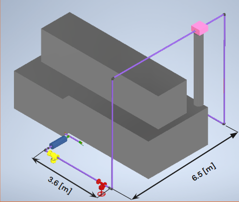
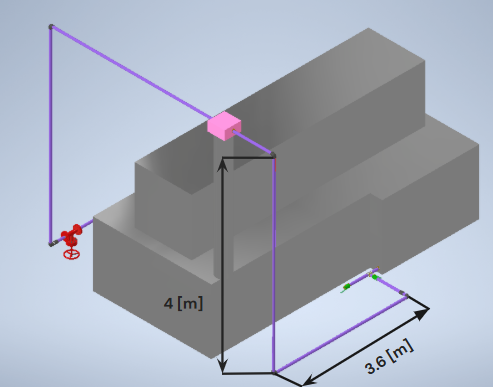
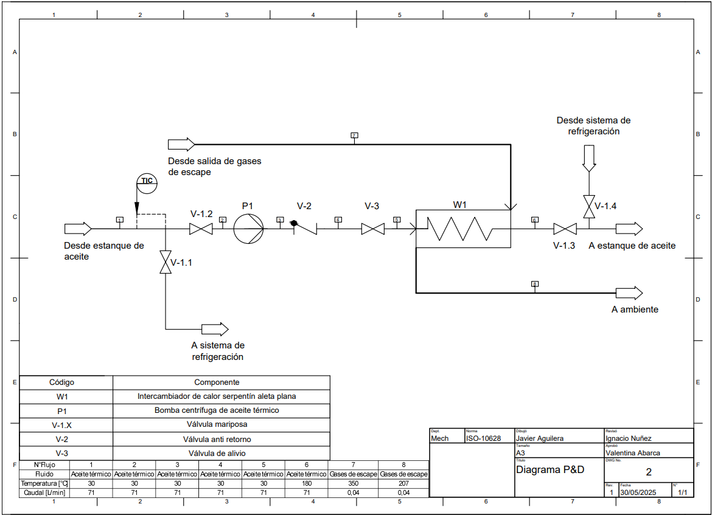

# Waste-Heat Recovery Feasibility Study with HORSE Chile

**Basic engineering and feasibility study | Project with HORSE Chile | Universidad de Chile | Autumn 2025**

[Back to portfolio](../../README.md)

## Engineering objective

Assess using heat from a heat-treatment furnace's exhaust to preheat quenching oil, reducing the duty required from the existing electric heaters. The proposed arrangement connects an additional oil circulation loop and heat exchanger to the existing system.

## My contribution

Within the student team, I focused on:

- Estimating combustion-product and exhaust-gas flow for the heat-recovery calculations.
- Calculating piping pressure losses and assessing pumping requirements.
- Evaluating pump options for the oil circuit and examining suction-side constraints.
- Building the economic assessment and comparing operating scenarios.

The team worked jointly on the overall study. The deliverable was basic engineering and feasibility analysis; HORSE Chile's engineering team handled subsequent detailed engineering.

## Proposed integration

| Piping arrangement, view 1 | Piping arrangement, view 2 |
| --- | --- |
|  |  |

*Original team concept views, Figure 8 of the report. The proposed loop routes oil through a heat exchanger exposed to furnace exhaust and returns it to the existing process.*

*Original team P&ID, Figure 10. Drawn by Javier Aguilera, reviewed by Ignacio Núñez and approved by Valentina Abarca, as credited in its title block. It provides integration context for my calculations. Original concept-stage labels are retained; the diagram's numerical annotations are not presented here as verified final operating conditions.*

## Engineering workflow

1. Establish the furnace and oil-heating conditions used as calculation inputs.
2. Estimate exhaust flow and the heat available for recovery.
3. Define the proposed oil route and assess temperature-dependent piping losses.
4. Compare pump performance against the circuit requirements and examine available versus required NPSH.
5. Evaluate capital and operating costs across different heating-use scenarios.

The study connected thermal calculations with hydraulic feasibility: the report's suction-side assessment identified a need to revise the proposed piping and exchanger flow passages. This was a design iteration to resolve before final equipment selection.

## Economic assessment

The team compared the existing electric-heating arrangement with the proposed heat-recovery system over a ten-year horizon and varied the weekly heating demand. Estimated investment, electricity use, tariffs and operating assumptions were inputs to that comparison.

These are modelled scenarios from a 2025 academic study. Plant savings and payback were not measured, and the financial model requires reconciliation before publishing a headline savings percentage or a single payback period.

## Outcome and engineering relevance

The team delivered a calculation report, proposed piping and process diagrams, equipment comparisons and a scenario-based economic model. My contribution connected fluid mechanics, equipment selection and economic feasibility in an automotive manufacturing setting.
